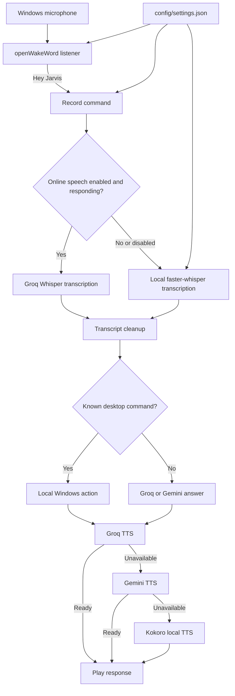

# Jarvis Project Documentation

Updated: 2026-10-06

## What Jarvis is

Jarvis is a Windows desktop voice assistant. It listens for a wake phrase, records
spoken commands, tries local Windows actions first, and sends ordinary questions
to online AI services. Jarvis runs as a background voice assistant without a
desktop or web interface.

The project is Python-based. Windows APIs are used for window operations, audio,
and system actions, so this project is designed for Windows.

### Main technology

| Part | Technology |
| --- | --- |
| Desktop core | Python 3.10–3.12, Win32 APIs. |
| Wake detection | openWakeWord with the `hey_jarvis_v0.1.tflite` model. |
| Microphone and audio | sounddevice, NumPy, WAV audio at 16 kHz mono. |
| Online STT and AI | Groq; Gemini is the alternate AI answer provider. |
| Offline STT | faster-whisper / CTranslate2. |
| Speech output | Groq TTS, Gemini TTS fallback, then Kokoro ONNX local fallback. |

## Quick start

1. Install Python 3.10, 3.11, or 3.12 and make sure `python` is available in
   Command Prompt or PowerShell. Python 3.12 is also used for the separate
   Kokoro speech-output worker.
2. Run `setup.bat` from this project folder. It creates `.venv`, installs
   `requirements.txt`, creates `.env` from `.env.example` if needed, and tries to
   set up the optional `.ttsenv` worker with Python 3.12.
3. Edit `.env` and add the API keys you have. `GROQ_API_KEY` enables online
   transcription and Groq answers; `GEMINI_API_KEY` enables Gemini answers and
   fallback. Keep these keys private.
4. Review `config/settings.json` and adjust Jarvis settings if needed.
5. Run `start_jarvis.bat`.
6. Say **“Hey Jarvis”**, wait for the acknowledgement, then speak a command or
   question. Say **“go to sleep”** to return to wake-word listening.

The launcher starts the voice core. Closing the launcher console stops Jarvis.
To stop it explicitly, use `stop_jarvis.bat`.

## Main interaction flow

### Listening and exit states

- In standby, the core keeps the microphone open for the wake phrase.
- After waking, Jarvis enters active conversation mode; another wake phrase is
  not required for each command.
- “Stop”, “cancel”, and similar phrases stop current speech playback.
- “Go to sleep” returns to wake-word standby.
- The first “bye” or “exit” enters a 25-second confirmation standby. Say “bye” or
  “exit” again during that window to terminate, or say “Hey Jarvis” to wake. If
  the window expires, Jarvis returns to normal wake-word standby.

## Speech recognition and voice output

### Speech recognition (STT)

- Online STT uses Groq's transcription endpoint with a reusable HTTP connection.
- The Whisper vocabulary prompt is intentionally kept short to stay within the
  provider's prompt limit.
- Local STT uses `faster-whisper`. It is started in a background thread when the
  voice core launches, at below-normal thread priority, so model initialization
  does not block the wake listener.
- Live recorder audio is decoded from its in-memory 16 kHz WAV with `soundfile`.
  `requirements.txt` also caps PyAV below version 19 for file inputs because
  `faster-whisper` currently passes an option removed by PyAV 19.
- The default local model is `base`, using CPU `int8`. Select `cuda` or `auto` in
  `config/settings.json` to request GPU or automatic device selection. If the
  chosen GPU or compute mode cannot start, Jarvis retries with CPU `int8`.
- The model files are not included in this project. The first use needs an
  internet connection to download them into Hugging Face's model cache. Once
  cached, local transcription can work without the network. If online STT is
  disabled, Jarvis goes straight to the local recognizer.
- If online STT is enabled but unreachable, it can wait up to its configured
  timeout before switching to the local recognizer. Lower
  `speech.online.timeout_seconds` for quicker failover, or set
  `speech.online.enabled` to `false` to use local STT every time.
- If both `speech.online.enabled` and `speech.local.enabled` are false, STT has
  no enabled recognizer and returns no transcript.
- Transcript cleanup corrects a small set of common recognition errors before
  command matching, including common KGF and YouTube command mishearings and
  shortened commands captured during interruption.

### Voice output (TTS)

- `voice/tts.py` tries Groq Orpheus TTS first, then Gemini TTS if Groq is
  unavailable. If both online providers fail, it starts the persistent Kokoro
  ONNX worker as a local fallback.
- Kokoro uses the files in `models/kokoro/` and starts only when online TTS
  fails or is disabled, so successful online speech avoids local model startup.
- The worker environment is separate from the main app. It uses Python 3.12 and
  `tts-requirements.txt`; if Python 3.12 is unavailable during setup, online
  speech still works when a Groq or Gemini key is configured, but local Kokoro
  fallback is unavailable.
- Jarvis listens for interruptions during playback. `audio.tts_volume` controls
  Jarvis's spoken reply volume. The spoken “volume up/down” commands control
  Windows system volume; these are separate settings. The interrupt listener
  compares microphone blocks with the active playback reference to reject
  speaker echo, so echoed replies do not retrigger the command that produced
  them.

### AI fallback and answer checks

- Groq failures and empty responses fall back to Gemini; Gemini tries its
  configured model list and can fall back to Groq for complex prompts.
- Empty or visibly cut-off provider responses are rejected before speech
  playback, instead of being spoken as fragments.
- Local YouTube playback commands and sequential actions are handled before
  AI routing when their intent is recognized.

### App, browser, and media routing

- VLC's `F` hotkey is sent only to a window owned by `vlc.exe`. VLC maximize
  and fullscreen commands use `F`; minimizing a fullscreen VLC video exits
  fullscreen first, then minimizes the window through Windows. Other apps use
  `F11` for current-window maximize/fullscreen commands. Explicit app maximize
  and normal minimize/restore use verified Windows window-state changes.
- Website destinations are shared across navigation, search, media controls,
  and chained commands. “Open Chrome in Reddit and search cats” searches
  Reddit in Chrome; “open Reddit in Chrome” and “open Chrome in Reddit” both
  retain the named browser. Common services have direct search routes, and
  explicit domains can be used when a site name is not in the built-in list.
- “Play [title] in YouTube” searches YouTube for the first matching video. If a
  browser is named, or selected earlier in the same command chain, Jarvis opens
  the result there. Otherwise it prefers the current browser context and then
  Windows' default browser.
- “Play video in YouTube” resumes the current YouTube player when its tab is
  open. If there is no YouTube tab, Jarvis opens YouTube and asks for the title.
- Named app destinations are focused or opened before search and media
  commands. VLC media searches launch the matched local file through VLC;
  Spotify opens its search, while other websites open search results for the
  user to choose from instead of claiming playback has started. Native app
  search uses the app's common `Ctrl+F` search shortcut.
- If the desktop launch fails, Jarvis may open the web client for WhatsApp,
  Spotify, or Discord. This fallback is intentionally limited to those apps;
  native-only applications such as VLC do not get redirected to a web search.
  For other sites, say “open [name] website” or provide its domain; unknown app
  names are not guessed as web searches.

## Settings reference

Edit `config/settings.json` while Jarvis runs; valid changes are reloaded
automatically. `core/settings.py` validates and clamps numeric values to safe
ranges. Missing or invalid JSON falls back to the
built-in defaults; unknown setting names are ignored. Keep the JSON structure
and commas valid. See `config/README.md` for editing guidance and
`config/command_corrections.json` for live speech aliases.

### `audio`

| Setting | Default | Effect |
| --- | ---: | --- |
| `tts_volume` | `0.4` | Jarvis speech playback level; range 0 to 1. |
| `energy_threshold` | `0.015` | Minimum microphone energy to start a recording. |
| `silence_duration_seconds` | `0.65` | Quiet time that ends a command recording. |
| `max_recording_seconds` | `10` | Maximum duration for one command recording. |
| `interrupt_threshold` | `0.015` | Microphone energy required to interrupt Jarvis speech. |
| `interrupt_min_speech_seconds` | `0.12` | Minimum speech time before accepting an interruption. |
| `interrupt_silence_seconds` | `0.65` | Quiet time that ends an interruption recording. |
| `max_interrupt_seconds` | `10` | Maximum length of an interruption recording. |
| `pre_roll_seconds` | `0.35` | Audio retained before interruption speech is detected. |

### `voice`

| Setting | Default | Effect |
| --- | ---: | --- |
| `wake_threshold` | `0.24` | Wake-word confidence threshold; range 0.01 to 1. |
| `required_detections` | `2` | Matching wake detections required; range 1 to 10. |
| `detection_window_seconds` | `1.5` | Time window for confirming the wake phrase. |

### `speech.online`

| Setting | Default | Effect |
| --- | --- | --- |
| `enabled` | `true` | Try online STT before local STT. Set false for local-only STT. |
| `model` | `whisper-large-v3-turbo` | Groq transcription model name. |
| `timeout_seconds` | `15` | Online STT request timeout; range 1 to 120 seconds. |
| `keepalive_connections` | `5` | Reusable HTTP connections; range 1 to 50. |
| `max_connections` | `10` | Maximum HTTP connections; range 1 to 100. |
| `keepalive_expiry_seconds` | `300` | How long idle connections are kept; range 1 to 3600 seconds. |

### `speech.local`

| Setting | Default | Effect |
| --- | --- | --- |
| `enabled` | `true` | Enables local STT fallback. |
| `preload_on_startup` | `true` | Warm the local model after core launch. |
| `preload_delay_seconds` | `0.6` | Delay before background model initialization. |
| `model` | `base` | `tiny`, `base`, `small`, `medium`, `large-v3`, or `large-v3-turbo`. |
| `device` | `cpu` | `cpu`, `cuda`, or `auto`. |
| `compute_type` | `int8` | `auto`, `int8`, `int8_float32`, `int8_float16`, `float16`, or `float32`. |
| `cpu_threads` | `4` | CPU threads; range 1 to 64. |
| `workers` | `1` | Model workers; range 1 to 8. |
| `beam_size` | `1` | Recognition search width; range 1 to 5. |
| `vad_filter` | `true` | Filter silence before recognition. |
| `vad_min_silence_ms` | `300` | Silence interval for VAD; range 50 to 3000 ms. |

For NVIDIA CUDA, `float16` or `int8_float16` may be a better fit than the CPU
default. Unsupported combinations automatically retry with CPU `int8`.

### `speech.tts`

| Setting | Default | Effect |
| --- | --- | --- |
| `online_enabled` | `true` | Try online TTS providers before Kokoro. |
| `groq_enabled` | `true` | Try Groq first when `GROQ_API_KEY` is configured. |
| `groq_model` | `canopylabs/orpheus-v1-english` | Groq speech model. |
| `groq_voice` | `troy` | Groq voice name. |
| `gemini_enabled` | `true` | Try Gemini after Groq when `GEMINI_API_KEY` is configured. |
| `gemini_model` | `gemini-3.8-flash-lite-tts` | Gemini speech model. |
| `gemini_voice` | `Kore` | Gemini voice name. |
| `local_voice` | `am_adam` | Kokoro voice profile sent to the local synthesis worker. |
| `timeout_seconds` | `10` | Per-request online TTS timeout; range 1 to 120 seconds. |
| `local_fallback_enabled` | `true` | Use Kokoro when online providers fail or are disabled. |

The wake-word model requires a 16 kHz audio sample rate, so it is fixed rather
than exposed as an editable setting.

Settings are loaded at process startup. Restart Jarvis after changing settings.
For camera control, edit `config/gesture_settings.json`. `hand_sign_mappings`
uses keys such as `1:ILoveYou` or `2:Open_Palm+Open_Palm`; values can be
`Open Calculator`, another allowlisted app launch, an explicit file or
executable path, or `Exit Jarvis`. Use `Open File: C:\path\file.pdf` for a
document and `Open App: C:\path\program.exe` for an executable. Existing paths
are checked before Windows opens them; arbitrary shell commands are not run. The
`input_style` section in `config/command_corrections.json` documents the
natural voice-input prefixes and filler handling.
The Voice Commands settings tab stores commands in the `voice_commands` table
inside `config/jarvis.db`. Add a phrase such as `start my music` and
map it to any free-form Jarvis command or action, such as `maximize + play`,
`Open App: C:\Games\osu!.exe`, or another command supported by the normal
command parser. Entries are shown in a scrollable, de-duplicated table, can be
edited or deleted, and are applied without restarting Jarvis. Phrase matching
trims and collapses whitespace and is case-insensitive. This is deliberately
separate from `corrections`, which remains reserved for phonetic and
misrecognition fixes. The SQLite database also stores editable hand-sign
mappings and camera-trained custom gestures; static camera settings and
default gesture mappings remain in `gesture_settings.json`. Existing JSON
entries are migrated automatically on first database access.
The Gesture Controls panel exposes the complete 16-entry default gesture
catalog, including dynamic gestures and two-hand combinations. The live
gesture preview is read-only: it draws detected hand landmarks, labels each
detected sign, and shows the stable combination key (for example
`2:Thumb_Up+Victory`) without executing its mapped action. Two-hand keys are
ordered consistently by detected left/right hand and can be mapped to
different signs.
Gesture camera performance is controlled by `camera_width`, `camera_height`,
`camera_fps`, and `recognition_fps` in `config/gesture_settings.json`.
Recognition defaults to 320x240 at 12 recognition frames per second. The
recognizer automatically uses one hand unless a `2:` MAP.03 mapping exists,
then switches to two hands. Camera buffering is limited to the newest frame,
and custom landmark matching runs on alternating recognition cycles.
Custom gesture action fields support sequential actions separated by `+`, for
example `maximize + play`. Actions run from left to right. Custom gesture
creation and deletion are persisted immediately and the UI refreshes from the
saved configuration after each operation.
MAP.03 named sign entries are also persisted immediately and rendered back into
the mapping list. Use the runtime key (`1:ILoveYou` or
`2:Open_Palm+Victory`) when the entry should be recognized by the camera; the
name/key is retained exactly as entered so it can be reused and deleted later.
Choosing `tiny` or `base` reduces local model memory and CPU/GPU work; larger
models can improve recognition at higher resource cost.

## Local desktop commands

Local actions are checked before an AI request. Supported categories include:

| Category | Example phrases |
| --- | --- |
| Apps | “Open Calculator”, “launch Chrome”, “open Task Manager”. |
| Windows | “switch to Chrome”, “maximize window”, “restore it”, “show desktop”. |
| Files and folders | “open Downloads”, “find file report.pdf”, “search everywhere for…”. |
| Media | “play…”, “pause”, “next track”, “play… on YouTube”, “play… in VLC”. |
| Websites | “go to YouTube”, “open Gmail”, “search cats on Reddit”, “open Chrome in YouTube”. |
| WhatsApp | “open WhatsApp chat with [contact]”. |
| System tools | time/date, calculator, system volume, screenshot, lock screen, network status, recycle bin, and index status. |
| Session context | “active folder”, “clear folder context”, “reset memory”. |

Multi-step commands can join supported actions with “then”, “and then”, “after
that”, or commas. A chain stops if a required step reports failure. Application
and file searches are best-effort and depend on Windows shortcuts, accessible
folders, and the local index. Website and YouTube searches may open a top result;
check the page before relying on it. Emptying the recycle bin is destructive.

## AI requests and session memory

If no local action matches, `core/router.py` sends the request to an online AI
provider. Complex requests try Gemini first and then Groq. Simple/default requests
try Groq first and then Gemini. Both services need their matching key in `.env`.
Without a working AI key, local desktop commands can still work, but general
questions cannot be answered by the cloud AI path.

`core/session_memory.py` stores up to 16 recent user/assistant messages in RAM
and tracks short-lived context such as the current folder, recent app, file,
media, and search. This in-process conversation context is cleared when the core
restarts; the project does not use this module as a permanent chat-history store.

## Project layout

| Path | Purpose |
| --- | --- |
| `main.py` | Single-instance voice-core entry point. |
| `start_jarvis.bat` | Starts the voice core and cleans up on exit. |
| `stop_jarvis.bat` | Stops the core. |
| `install_startup.bat` | Installs a Windows login shortcut to launch JARVIS. |
| `uninstall_startup.bat` | Removes the Windows login startup shortcut. |
| `setup.bat` | Creates environments and installs dependencies. |
| `config/settings.json` | User-editable runtime settings. |
| `config/README.md` | Settings and live command-correction instructions. |
| `config/command_corrections.json` | Static/user phonetic speech corrections. |
| `config/jarvis.db` | SQLite storage for custom voice commands and editable gesture mappings. |
| `core/settings.py` | Defaults, validation, range clamps, and shared settings. |
| `voice/wake_word.py` | Wake/active/sleep loop and command lifecycle. |
| `voice/recorder.py` | Microphone recording, silence detection, WAV creation. |
| `voice/stt_groq.py` | Online Groq speech transcription and fallback handoff. |
| `voice/stt_offline.py` | Background local Whisper preload and offline transcription. |
| `voice/stt_cleanup.py` | Transcript correction before command parsing. |
| `voice/tts.py`, `tts_worker.py` | Online-first speech output, interruption listening, and persistent local fallback worker. |
| `voice/tts0.py` | Older alternate TTS implementation; not used by the standard voice loop. |
| `core/router.py`, `core/ai.py` | Local-first routing and online AI responses. |
| `core/command_engine.py` | Parsing and sequential execution of command chains. |
| `core/event_logger.py`, `core/timing.py` | In-memory backend events and command timing. |
| `core/session_memory.py` | In-memory dialogue and action context. |
| `tools/system_tools.py` | Main local command dispatcher and Windows utilities. |
| `tools/window_tools.py` | Windows application and window management. |
| `tools/app_tools.py` | Installed-app shortcut discovery and launch. |
| `tools/file_tools.py` | File/folder lookup helpers. |
| `tools/app_actions/whatsapp.py` | WhatsApp contact/chat actions. |
| `DESKTOP_CHANGES.txt` | Historical desktop/command change summary. |
| `requirements.txt` | Main Python package dependencies. |
| `tts-requirements.txt` | Packages for the optional Python 3.12 Kokoro worker. |

## Runtime and user data

- `app_cache.json` caches names and Windows shortcut paths for installed apps.
- `data/jarvis_file_index.db` is the local file-search index.
- `jarvis.pid` and the single-instance mutex are runtime process bookkeeping.
- `voice/recordings/command.wav` is only written when
  `JARVIS_SAVE_RECORDINGS=1` is set in `.env` or the process environment. These
  WAV files can contain microphone audio; leave it at `0` unless recording is
  needed for troubleshooting.
- Whisper model files are downloaded to Hugging Face's model cache. Kokoro model
  files are stored under `models/kokoro/`.

The live event log keeps at most the most recent 30 events. Session memory is
separate and exists only while the core process is running.

## Privacy and network behavior

- The microphone remains open for wake-word detection while the voice core is
  running. Command recordings are kept in memory unless
  `JARVIS_SAVE_RECORDINGS=1` is enabled.
- With online STT enabled, recorded command audio is sent to Groq for
  transcription. If online STT is disabled, transcription uses the local model.
- Online TTS sends reply text to Groq and then Gemini if the previous provider
  fails; local Kokoro is used when cloud synthesis is unavailable and fallback
  is enabled.
- General questions that need an AI response are sent as text to Groq or Gemini.
- File indexing and desktop actions run locally. The file index and app cache
  contain local names/paths. Recent backend events are held in memory only.
- Keep `.env` private. Do not paste API keys into source code, project docs, or
  logs shared outside your machine.

## Troubleshooting

| Symptom | Check |
| --- | --- |
| Wake phrase is missed | Check microphone permissions/input device; adjust `voice.wake_threshold` and `voice.required_detections`. |
| Online speech takes too long to fail over | Reduce `speech.online.timeout_seconds` or set online STT off. |
| Online STT reports `BadRequestError` | Read the HTTP status and API reason printed by the voice core; check the configured Groq model and request details. Local STT remains the fallback. |
| Online speech output fails | Check `speech.tts`, `GROQ_API_KEY`, and `GEMINI_API_KEY`; Kokoro runs as a fallback when enabled. |
| Local speech is slow/not ready on first run | Allow the background model download to finish; check network access and available disk space. |
| Offline STT reports a PyAV `metadata_errors` error on an audio file | Run `setup.bat` to install the PyAV version range in `requirements.txt`; live microphone recordings use the soundfile decoder. |
| A TFLite runtime warning appears at wake startup | It is informational when openWakeWord reports the ONNX Runtime fallback and wake detections continue. |
| GPU choice does not stay on GPU | Check CUDA/CTranslate2 support; the code deliberately retries on CPU if GPU initialization fails. |
| No spoken response | Check online TTS keys and `speech.tts`; if using local fallback, check `.ttsenv`, Python 3.12 setup, and the Kokoro model files. |
| Volume setting seems unchanged | Edit `audio.tts_volume` in `config/settings.json`; Jarvis reloads it before the next spoken response. System volume is separate. |

## Optional startup shortcut and diagnostics

`install_startup.bat` creates a Windows Startup shortcut for JARVIS (`JARVIS.lnk`) in the Windows Startup menu (`%APPDATA%\Microsoft\Windows\Start Menu\Programs\Startup`). At login, it launches the voice core with `start_jarvis.bat`. To remove the shortcut, run `uninstall_startup.bat`.

`voice/mic_test.py` checks microphone input and `voice/test_wake.py` is a manual
wake-word check. These are helper scripts, not the full assistant launcher.
